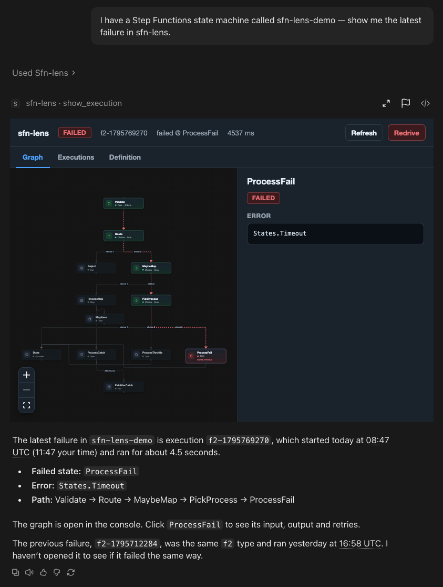
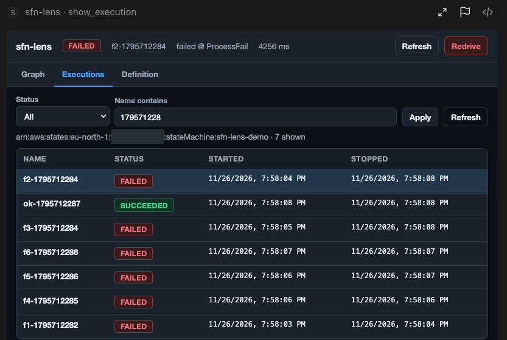

# sfn-lens

Step Functions debugging without leaving chat.

Ask Claude about a failed run and get an interactive console in the reply: the state machine graph with status and timings, click-through input/output, an executions list, the ASL definition, and optional redrive. Same idea as the AWS console — sitting next to the conversation.





Built as an [MCP App](https://modelcontextprotocol.io/extensions/apps/overview) for Claude Desktop (local AWS credentials over stdio).

## What you can do

- Open any execution and see the graph (Task, Choice, Parallel, Map, Catch, Retry)
- Follow the failed path; click a state for input, output, errors, and retries
- Browse recent executions with status / name filters
- Read the state machine definition
- Compare two runs
- Redrive a failed execution (opt-in; needs a confirm click)
- Refresh a live run; running executions poll automatically
- Try fixtures with no AWS account

The UI never talks to AWS directly — everything goes through the MCP server with your local credentials. Sensitive fields can be redacted before they hit the model or the panel.

## Setup (Claude Desktop)

Needs Node 20+ and an AWS profile that can read Step Functions.

```bash
git clone git@github.com:sakdag/sfn-lens.git
cd sfn-lens
npm install
npm run build
```

In `~/Library/Application Support/Claude/claude_desktop_config.json`:

```json
{
  "mcpServers": {
    "sfn-lens": {
      "command": "node",
      "args": ["/ABS/PATH/TO/sfn-lens/packages/server/dist/index.js"],
      "env": {
        "AWS_PROFILE": "personal",
        "AWS_REGION": "eu-north-1"
      }
    }
  }
}
```

Quit Claude fully and reopen. Then try:

> Show me the latest failed Step Functions run on my account — use sfn-lens so I can see the graph.

### Redrive (optional)

Add `"SFN_LENS_ALLOW_REDRIVE": "true"` to the `env` block and grant `states:RedriveExecution` on your IAM principal. Leave it off if you want read-only.

Redrive reuses the same execution ARN. If the workflow fails the same way again (same input, same `Reject` path, etc.), status will still be `FAILED` — look for `redriven ×N` in the header.

### Try without AWS

```json
"env": {
  "SFN_LENS_MODE": "fixture",
  "SFN_LENS_FIXTURE_DIR": "/ABS/PATH/TO/sfn-lens/fixtures"
}
```

Ask Claude to show fixture `f1-lambda-error`.

## Sample workflow

A small Terraform demo (default region `eu-north-1`) plus a fault-injection script, useful for trying the UI end to end:

```bash
cd demo/terraform
terraform init && terraform apply
export STATE_MACHINE_ARN=$(terraform output -raw state_machine_arn)
bash ../scripts/inject_faults.sh
```

`terraform destroy` when you’re done. The Lambda is tiny on purpose.

## Configuration

| Env | Default | Notes |
| --- | --- | --- |
| `AWS_PROFILE` | — | Optional; SDK default credential chain if unset (env keys, SSO, shared config) |
| `AWS_REGION` / `AWS_DEFAULT_REGION` | — | Optional; SDK / shared-config region if unset |
| `SFN_LENS_MODE` | `live` | `live` or `fixture` |
| `SFN_LENS_FIXTURE_DIR` | `fixtures/` | Offline recordings |
| `SFN_LENS_REDACT_JSONPATHS` | — | e.g. `$.customer.ssn,$.items[*].ssn` |
| `SFN_LENS_ALLOW_REDRIVE` | off | Set `true` to enable redrive |

Read IAM: `states:List*`, `Describe*`, `GetExecutionHistory`.  
Redrive: also `states:RedriveExecution`.

More on trust boundaries: [`docs/SECURITY.md`](docs/SECURITY.md).

## Development

```bash
npm install
npm run build
npm test
npm run typecheck
npm run eval:dry
npm run start:stdio
```

TypeScript throughout (MCP Apps SDK + UI in one toolchain). CI runs build, typecheck, tests, and the eval dry-run.

## Licence

Apache-2.0
